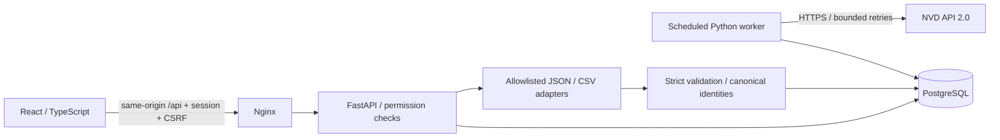
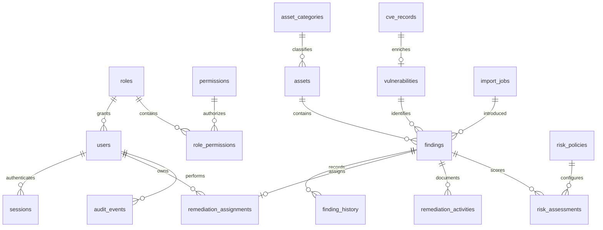

# VulnWatch architecture

VulnWatch is a **single-organization deployment**, not a multi-tenant SaaS. Deploy separate instances/databases for separate organizations. PostgreSQL is the production system of record; SQLite is used only for fast isolated tests and local preview.

## Trust boundaries

- The browser, uploaded data, and NVD responses are untrusted. No uploaded files are executed or persisted to disk. Descriptions are rendered as text, never HTML.
- Authentication uses random, server-revocable sessions; only a SHA-256 digest is stored. Cookies are HttpOnly, SameSite=Strict, and Secure outside explicit development mode. Writes require a per-session CSRF token and a trusted Origin.
- Roles map to permissions on the server: administrators manage users/policy/synchronization; analysts manage assets, imports and remediation; viewers read operational data. Audit access is administrator-only.
- No scanning, exploitation, outbound user-supplied URLs, or auto-following CVE reference URLs.
- API and worker share a database, not process memory. Synchronization uses a PostgreSQL advisory lock plus a visible lease and persists its watermark only after a complete window. Database-backed request buckets work across API replicas.

## Schema and invariants

Finding identity is SHA-256(asset canonical name, vulnerability canonical key, locator). A CVE key is shared across scanners; a non-CVE external key must be namespace-qualified. Scanner source is provenance, not identity. Unique constraints enforce deduplication; reimports update last-seen and occurrence count, never erase remediation/history. A verified finding seen again is reopened. Imports are all-or-nothing and rejected batches retain only safe error metadata.

Risk assessments are immutable historical snapshots. Custom priority is CVSS base score (or an explicitly labeled unknown-score baseline), asset criticality and exposure, capped at 100. It is **not CVSS**. Policy changes append assessments for all findings. Dashboard trends are daily historical snapshots of assessment events, not a claim to reconstruct asset inventories before import.

## Implementation phases and acceptance gates

1. Foundation: normalized models, initial Alembic migration, FK/unique/check constraints, database integrity tests.
2. Authentication: role bootstrap, Argon2 passwords, session revocation/expiry, Origin/CSRF enforcement, permission and authentication tests.
3. CVE ingestion: actual NVD transport, pagination/retries, robust optional fields, persisted synchronization cursor, failure tests.
4. Assets/findings: strict adapters, transactional imports, canonical duplicate detection, malicious-file tests.
5. Risk: configurable policy, unknown-score semantics, immutable assessments, formula/threshold tests.
6. Remediation: assignments/deadlines, allowed state transitions, verification evidence, reopening, activity/audit history, workflow tests.
7. UI/reporting: live API queries, filters, charts, asset report, aging/performance/export, Playwright workflow.
8. Release: full tests/build, threat model, operational documentation and screenshots. External services and PostgreSQL checks must be reported separately if unavailable.
